# AutoOnboard

**Automated privileged-account discovery, classification and vault onboarding**, a working re-creation of the CyberArk *Accounts Discovery → onboarding → CPM rotation* workflow built entirely on free tooling: OpenLDAP, HashiCorp Vault, Linux containers, Python.

One command (`make demo`) builds a fictional company, finds its privileged accounts, classifies them with rules plus a gradient-boosting model, asks a human to approve onboarding, vaults the approved accounts into safes with least-privilege policies, rotates and verifies their passwords, simulates out-of-band changes that the CPM reconciles, and produces an HTML/PDF report plus a tamper-evident audit evidence bundle.

[](https://github.com/Harshitraiii2005/Automated-Privileged-Account-Discovery-Onboarding/actions/workflows/ci.yml)
[](https://harshitraiii2005.github.io/Automated-Privileged-Account-Discovery-Onboarding/)

**Live demo: [harshitraiii2005.github.io/Automated-Privileged-Account-Discovery-Onboarding/](https://harshitraiii2005.github.io/Automated-Privileged-Account-Discovery-Onboarding/)**. Results of a real run, an account explorer, the incident timeline and the full audit report ([HTML](https://harshitraiii2005.github.io/Automated-Privileged-Account-Discovery-Onboarding/report.html), [PDF](https://harshitraiii2005.github.io/Automated-Privileged-Account-Discovery-Onboarding/report.pdf)).

[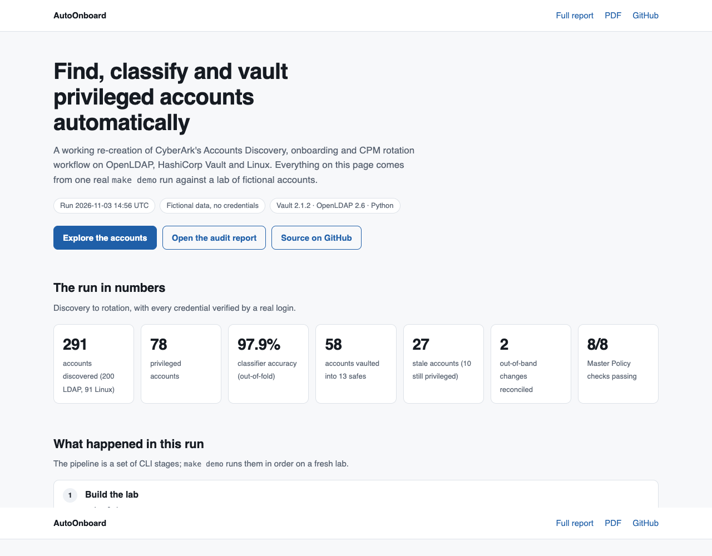](https://harshitraiii2005.github.io/Automated-Privileged-Account-Discovery-Onboarding/)

> Every account, person and credential in this repository is fictional. No secret is committed: `.env` and all generated key material are git-ignored and created locally from `.env.example`.

---

## Results (real run)

Measured on 2026-11-03: `make demo` from a clean reset on Apple Silicon (Docker Desktop 29.7, images already built) took **49–91 s** end to end (three runs). The seed is deterministic, so repeated runs give the same counts and even the same plan hash.

| Stage | Result |
|---|---|
| Lab health check | **21/21** checks pass (TLS, ACLs, Vault state, pinned SSH host keys, least-privilege sudo) |
| Discovery | **291** accounts: 200 LDAP + 91 Linux (3 hosts); **78** privileged (51 LDAP, 27 Linux); 12 local accounts with an SSH key that unlocks another identity |
| Classification (239 labelled accounts, 5-fold out-of-fold) | rules **95.8 %** · gradient boosting **97.5 %** · hybrid **97.9 %** accuracy (macro-F1 0.911 / 0.952 / 0.958) |
| Onboarding plan | **58** onboard (28 LDAP-SVC, 16 LDAP-ADM, 9 LDAP-SHARED, 3 UNIX-SHARED, 2 UNIX-ROOT), **36** remediate, **13** review |
| Onboarding | 58/58 vaulted in 13 safes (10 LDAP, 3 UNIX); all 58 changed on onboard **and verified**; re-run is a no-op (58 skips) |
| CPM, failure simulation | 2 out-of-band changes detected and **reconciled** (warning alerts); 1 expired account **failed reconcile** (critical alert), recovered after the expiry was removed |
| Forced rotation | 53 LDAP rotated by Vault + 5 Linux changed by the CPM, all verified |
| Safe membership | A *Database Team* member, logged into Vault with directory credentials, could read `LDAP-DBA` and was **denied** `LDAP-ENGINEERING` |
| Report | Master Policy checks **8/8 PASS**; credential-access table built from the Vault audit log |

Hybrid classifier per class:

| Label | Precision | Recall | F1 | Support |
|---|---|---|---|---|
| human_admin | 1.000 | 1.000 | 1.000 | 32 |
| service | 0.976 | 0.953 | 0.965 | 43 |
| shared | 0.867 | 0.867 | 0.867 | 15 |
| stale | 0.960 | 0.960 | 0.960 | 25 |
| standard | 0.992 | 1.000 | 0.996 | 124 |

All 5 errors, unedited: `ldap:tableau` (service → shared), `ldap:svc-print` (service → standard), `linux:db01:oracle` (shared → service), `linux:app01:root` (shared → stale), `linux:app01:ubuntu` (stale → shared). [Limitations](#limitations) explains why these numbers flatter the model.

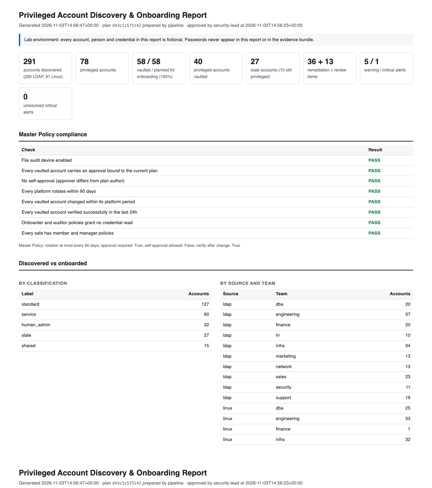

---

## Quick start

Prerequisites: Docker with Compose v2, [uv](https://docs.astral.sh/uv/), GNU make. Chrome or Chromium is optional (PDF output).

```bash
make demo          # fresh lab + the whole pipeline (first run also builds 4 images)
open out/report/report.html
make serve         # API + report on http://127.0.0.1:8000 (OpenAPI docs at /docs)
make site          # rebuild the static demo page in site/ from the last run
make lab-reset     # remove containers, volumes, generated keys and outputs
```

Step by step:

```bash
make lab-up && make lab-health
uv run autoonboard discover                  # -> out/inventory.{json,csv}
uv run autoonboard classify                  # -> out/classification.{json,csv}, out/classification_metrics.json
uv run autoonboard plan --prepared-by pipeline
uv run autoonboard approve --approver security-lead      # interactive: all / one by one / none
uv run autoonboard onboard --dry-run         # every Vault change, nothing written
uv run autoonboard onboard
uv run autoonboard cpm                       # verify; change what is due; reconcile drift
uv run autoonboard simulate failures         # rogue-admin scenarios
uv run autoonboard cpm                       # exits 1: one account needs manual intervention
uv run autoonboard simulate restore && uv run autoonboard cpm
uv run autoonboard report --pdf && uv run autoonboard evidence
```

`make test` runs the unit tests; `make lint` runs ruff and mypy.

---

## Architecture

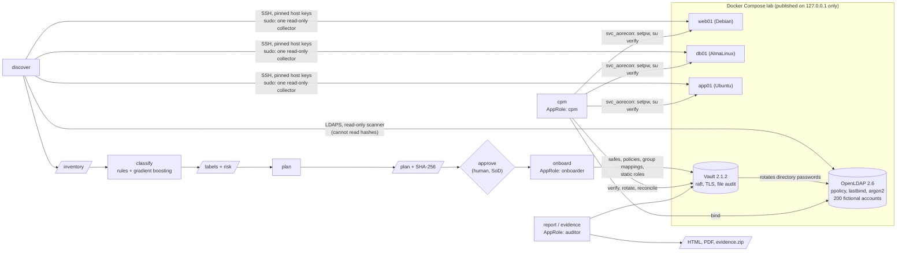

How the CPM changes a Linux password. The new password is stored as *pending* **before** it is set, so a crash mid-change can never lose the only copy:

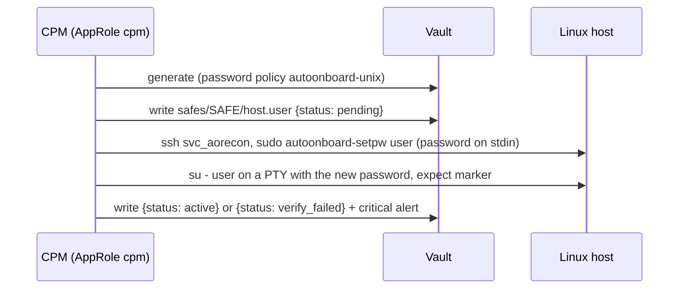

## CyberArk mapping

| CyberArk | AutoOnboard |
|---|---|
| **Accounts Discovery** | `discover`. LDAP: nested group resolution, password age (`pwdChangedTime`), last logon (`pwdLastSuccess`), disabled (`pwdAccountLockedTime`), never-expiring policy, owner. Linux: a root-owned collector reports passwd, *password status only* from shadow, sudoers and authorized_keys; discovery parses them and correlates local accounts with directory identities. |
| **Pending accounts / onboarding rules** | `out/onboarding_plan.json`, produced by `onboard.decide()`: *onboard*, *remediate* (stale, duplicate UID 0, admin rights on a daily account) or *review* |
| **Dual control** | `approve`: the approval is bound to the plan's SHA-256 and the plan author cannot approve their own plan |
| **Vault** | HashiCorp Vault in production mode (raft storage, TLS, manual unseal, file audit device enabled first) |
| **Safe** | KV v2 folder `safes/<SAFE>/` + ACL policies `safe-<safe>-users` / `safe-<safe>-managers` |
| **Safe members & permissions** | Directory groups mapped to those policies through Vault's LDAP auth method. Members get List + Retrieve + Use; managers (Security Team) get Manage + Initiate change and **no Retrieve** |
| **Platform** | `cpm.PLATFORMS`: `LDAP-SVC` 30 d, `LDAP-SHARED` 7 d, `LDAP-ADM` 1 d, `UNIX-ROOT` 7 d, `UNIX-SHARED` 7 d, each with a verify/reconcile method |
| **Password complexity** | Vault password policies `autoonboard-ldap` (32 chars) and `autoonboard-unix` (24 chars), 4 character classes |
| **CPM change** | LDAP: Vault static role (Vault rotates on schedule). Linux: `cpm.change_unix` (pending → set → verify → active) |
| **CPM verify** | A real login: LDAP bind, or `su` on a PTY through the logon account |
| **Reconciliation / reconcile account** | Verify failure triggers a reset by a privileged identity: Vault's `vault-rotator` (its own password rotated by Vault, unknown to humans) or `svc_aorecon` (SSH key stored only in Vault) |
| **Change on onboard** | Static-role import rotation (LDAP); immediate CPM change (Linux) |
| **Master Policy** | `cpm.MASTER_POLICY` (max 90-day rotation, approval required, no self-approval, verify after change), checked in the report |
| **Activities / audit** | `out/events.jsonl` (CPM activity log; warning/critical entries are alerts) + Vault audit log → "who read which credential" |
| **PVWA reports** | HTML/PDF report, FastAPI (`/api/inventory`, `/api/classification`, `/api/plan`, `/api/events`, `POST /api/approvals`) |
| **PSM, exclusive check-out / one-time passwords, dependencies** | Not implemented (see [Limitations](#limitations)) |

---

## The lab

`make lab-gen` writes everything to the git-ignored `lab/.generated/`: random `.env` secrets, a lab CA (its private key is never written to disk), server certificates, SSH host keys, tooling keys, the LDAP seed and the ground truth. Structure is deterministic (seed 42); key material and passwords are random. Seeded account passwords exist only as salted hashes, so **nobody knows them**, which is exactly the situation a PAM onboarding project inherits.

**Directory (OpenLDAP 2.6):** 200 accounts (118 standard, 24 admins, 30 service, 8 shared, 20 stale) in 19 groups, with deliberate real-world mess:

- 3 leavers still in privileged groups; 4 disabled; 5 never logged in.
- 4 orphaned service accounts whose owner left; 3 stale `adm-` accounts.
- `svc-patching` is a Domain Admin **only through a nested group**.
- Service accounts in Domain Admins; about 70 % of service passwords never changed.
- Service accounts misfiled in `ou=People` or cloned from a human template.
- Admins working from their daily (mailbox) account.

The server keeps the history attributes live (`pwdChangedTime`, `pwdLastSuccess`), so Vault's rotations show up in later discovery runs.

**Linux (Debian, AlmaLinux, Ubuntu):**

- `toor` with UID 0.
- Root accepting an unattributed key.
- A CI key reused by two accounts on two hosts.
- `NOPASSWD: ALL` service accounts.
- Shared logins carrying 3–4 people's keys.
- A locked leaver still in `wheel`.
- Leavers' keys still installed.
- An expired contractor account.
- Ubuntu's default `ubuntu` user, which ships in the `sudo` group.

**Tooling identities (least privilege):**

| Identity | Can do | Cannot do |
|---|---|---|
| `discovery-scanner` (LDAP) | read the directory, including ppolicy attributes | read password hashes, see `ou=System` |
| `svc_aoscan` (Linux) | `sudo` one root-owned collector, **no arguments** | anything else as root; it never sees a hash |
| `vault-rotator` (LDAP) | write `userPassword` | its password is known only to Vault (`rotate-root`) |
| `svc_aorecon` (Linux) | `sudo autoonboard-setpw USER` (password on stdin) | read shadow; its key lives only in Vault |
| AppRole `onboarder` | create safes, policies (`safe-*` only), group mappings, static roles, metadata | read or set any credential |
| AppRole `cpm` | read, rotate and verify credentials | change policies, safes or auth |
| AppRole `auditor` | read configuration, metadata, rotation state, audit config | read any credential |

## Classification and risk

Labels:
- `human_admin`: privileged account tied to one person.
- `service`: used by software.
- `shared`: privileged account used by several people (root, `dbadmin`, `ops`).
- `stale`: idle 90+ days, never used, disabled or expired, or its directory twin is gone.
- `standard`: personal and unprivileged.

- **Features (33):**
  - privilege (effective groups, UID 0, sudo ALL/NOPASSWD)
  - hygiene (password age, last logon, never-expires, credential presence)
  - identity hints (mail, employee type, owner and owner state, OU, person-like display name, naming patterns)
  - SSH keys (count, reuse)
  - cross-source correlation
- **Rules:** a transparent baseline (`classify.rule_label`).
- **Model:** scikit-learn `GradientBoostingClassifier` with default parameters.
- **Hybrid:** hard staleness evidence from the rules always wins; otherwise the model decides. Staleness is a fact you can read off an account; *service vs shared vs admin* is the fuzzy part where a model earns its place.
- **Honest evaluation:** every labelled account's prediction comes from 5-fold stratified cross-validation, i.e. from a model that never saw it. The design was fixed before looking at the errors, and nothing was tuned on them.
- **Risk score (0–100, additive and explained per account):**

  | Signal | Points |
  |---|---|
  | UID 0 | +40 |
  | Effective Domain Admin / sudo ALL / other privilege | +35 / +30 / +20 |
  | Empty password | +30 |
  | Stale but privileged | +20 |
  | Local account outlived its directory identity | +15 |
  | Passwordless sudo | +10 |
  | Password older than a year | +10 |
  | Key reused | +10 |
  | Owner gone | +10 |
  | Shared privileged credential | +10 |
  | Privileged and never expires | +5 |

  Severity bands: ≥70 critical, ≥40 high, ≥20 medium.

## Reporting and audit evidence

`autoonboard report --pdf` renders `out/report/report.html` (PDF via headless Chrome). The report covers:

- KPIs and the Master Policy checks.
- Discovered vs onboarded, by label and by team.
- Safes with their members, managers and policies.
- Platforms and alerts.
- Every vaulted account with its rotation state.
- Stale accounts with evidence and risk factors, and the remediation list.
- Credential reads from the Vault audit log.
- Classifier accuracy and errors.
- The CPM activity log, Vault configuration, and an indicative NIST 800-53 mapping (AC-2, AC-2(3), AC-6, AC-6(5), IA-5(1), AU-2/12, AU-6).

`autoonboard evidence` zips the inventory, classification, metrics, plan, approval, event log, report, Vault snapshot (no secrets), Vault audit log (values HMAC'd by Vault) and the Vault policy files, together with a `MANIFEST.json` of SHA-256 hashes and the git commit.

## Security considerations

- **Credentials stay in their trust zone.** No output file contains a password. Discovery cannot read hashes (LDAP ACL; the collector reduces shadow entries to a status). The CPM passes passwords on stdin, never in argv (`ps`), and logs only outcomes.
- **No trust on first use.** TLS everywhere with a lab CA whose key is never written; LDAP listens on LDAPS only, with no anonymous binds and simple binds requiring an encrypted connection; SSH host keys are pre-generated and pinned (`RejectPolicy`); ports bind to 127.0.0.1.
- **Separation of duties.** Plan author ≠ approver. The onboarder cannot touch credentials, safe managers cannot retrieve them, the auditor reads only metadata, and discovery and the CPM use different accounts and keys.
- **Tamper evidence.** The approval is bound to the plan hash (a hand-edited or regenerated plan is refused before Vault is touched). The evidence manifest hashes every file. The Vault audit device is enabled before any other configuration, so the whole setup is itself audited.
- **Secrets hygiene.** `.env` and `lab/.generated/` are git-ignored, `.env.example` holds placeholders only, and CI runs gitleaks.

**Known weaknesses, accepted for a lab:**
- The single unseal key and the root token sit in `lab/.generated/vault/init.json` (0600). Production: auto-unseal or Shamir custodians, and revoke root.
- `LDAP_ADMIN_PASSWORD` is passed as a container env var, visible to anyone with Docker access (who is root-equivalent anyway).
- AppRole secret IDs don't expire and aren't CIDR-bound.
- The reconcile account is root-equivalent **by design** (so is CyberArk's reconcile account for root); its key lives only in Vault.
- The onboarder may write any `safe-*` policy body, so whoever controls it can grant a directory group access. Production would review policy diffs or use Sentinel/EGPs.
- Vault's LDAP auth reuses the read-only scanner as its search account.
- Seed hashes are `{SSHA}`: acceptable only because those passwords are 32 random characters; anything set later is argon2.
- API GET endpoints are unauthenticated (loopback only, and they serve no secrets); POST requires a bearer token.

## Limitations

- **Synthetic data flatters the model.** The accuracy numbers measure how well the pipeline separates the personas the generator models, not real-world performance, and `stale` is essentially a rule. There is no external validation set.
- **A misclassification has consequences.** The vendor `ubuntu` account (dormant, no password, but in `sudo`) was classified *shared* and onboarded in the auto-approved demo, which **gave a dormant sudo account a working password**. That is precisely why approval is a human step; a stricter rule would send any account without a usable credential to *remediate*.
- **No Windows/AD.** Samba AD in containers needs privileged mode, and AD will not let you backdate `pwdLastSet`/`lastLogonTimestamp`, so a seeded ground truth would be impossible. The LDAP code maps 1:1 to AD attributes.
- **Not implemented:**
  - SSH key management: keys are inventoried and flagged only.
  - Session isolation and recording (PSM).
  - Exclusive check-out: Vault LDAP library sets would be the fit.
  - Service-account dependency management: rotating a real app's service password would break it.
- **No Linux last logon:** `lastlog` cannot be meaningfully backdated, so it isn't collected.
- **sudoers aliases** are reported verbatim, not expanded.
- **Simple CPM scheduler:** `cpm --loop` is a sleep loop. Production would use a scheduler with locking.
- **Single-node Vault.** The report reads the audit log through `docker compose exec`; production would ship it to a SIEM.

## Design decisions (interview notes)

- **Why OpenLDAP instead of Samba AD?** Ground truth needs backdated password age and last logon. OpenLDAP's ppolicy keeps real equivalents of `pwdLastSet` and `lastLogonTimestamp`, and an offline `slapadd` can seed history, which AD forbids.
- **Why not run Vault in dev mode?** Dev mode skips everything a PAM engineer is asked about: unsealing, TLS, storage, audit.
- **Why three AppRoles?** The long-running CPM is the most exposed component, so it must not be able to change policy. The onboarder changes policy, so it must never see a credential.
- **Why rotate on import?** You inherit passwords that are unknown, shared and old. Rotating immediately makes Vault the only holder, the same as CyberArk's change on onboard.
- **Why verify by logging in?** A rotation that isn't proven by a login is a hope, not a control.
- **Why store the new password as pending first?** Ordering is the difference between a failed rotation and a lost credential.
- **Why is the risk score rule-based and not ML?** Auditors need to know *why* an account scores 75; additive factors explain themselves.
- **What would change in production?**
  - Auto-unseal and HA Vault.
  - AD via LDAPS.
  - Reconcile and logon accounts per platform.
  - Dependency mapping before rotating service accounts.
  - Vault library sets for check-out.
  - Audit shipped to a SIEM.
  - Approvals in the ticketing system.

## Project layout

```
compose.yaml, Makefile, .env.example
.github/workflows/ci.yml     lint, types, tests, secret scan, full `make demo` end to end
.github/workflows/pages.yml  publishes site/ to GitHub Pages
site/              the live demo page (generated by `make site`, committed)
docs/screenshots/  README images, all from one real run
lab/ldap/          OpenLDAP image: cn=config, first-boot slapadd seeding, ACLs
lab/host/          Linux host image: provisioning, sshd baseline, collector, setpw
lab/vault/         Vault config + onboarder/cpm/auditor policies
src/autoonboard/
  config.py        endpoints, paths, TLS/SSH/Vault connection factories
  discovery.py     phase 2: LDAP + Linux discovery, correlation, inventory
  classify.py      phase 3: features, rules, gradient boosting, risk
  onboard.py       phase 4: plan, approval (SoD + hash binding), safes, apply / dry-run
  cpm.py           phase 5: platforms, Master Policy, verify / change / reconcile, events
  report.py        phase 6: report, PDF, evidence bundle, static demo page
  api.py, cli.py   phase 7: FastAPI and rich CLI
  lab/             seed generator, Vault bootstrap, health check, failure scenarios
tests/             unit tests (parsers, rules, approval controls, report, API)
```

## Live demo and screenshots

The [live demo page](https://harshitraiii2005.github.io/Automated-Privileged-Account-Discovery-Onboarding/) is a static page built by `make site` (`autoonboard site`) from the output files of a real local run: no lab or secret is needed to serve it. `.github/workflows/pages.yml` publishes `site/` to GitHub Pages whenever it changes on `main`. It contains the run's numbers, an incident timeline of the CPM scenarios, a filterable explorer of all 291 accounts (label, risk factors, onboarding decision, and where the classifier disagreed with ground truth), the classifier's confusion matrix, the safes, and the full HTML/PDF report.

Every screenshot below comes from the same `make demo` run (fictional data).

**The pipeline in the terminal**: discovery, classification and the onboarding plan:

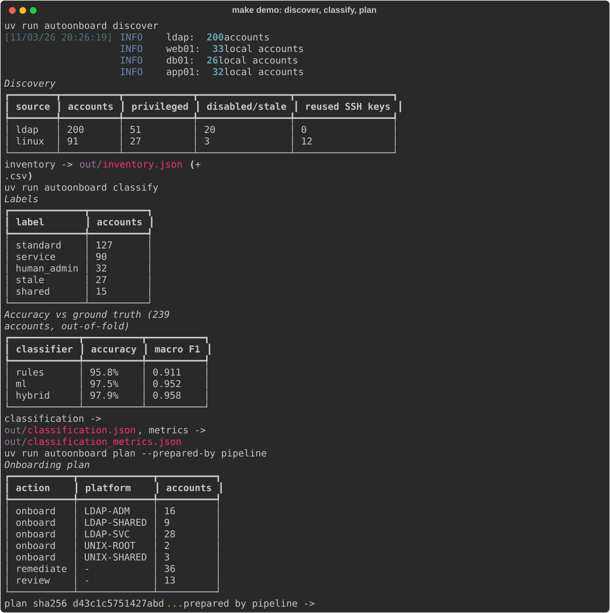

**Out-of-band changes, then the next CPM cycle**: two drifts reconciled, one expired account escalated as critical:

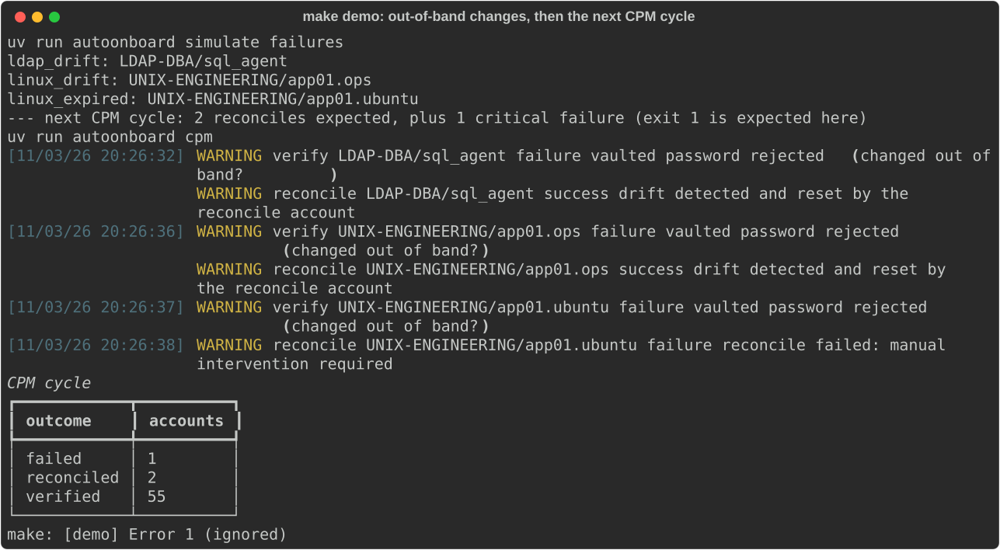

**Report: Alerts**, every warning and critical event, and whether it was resolved later:

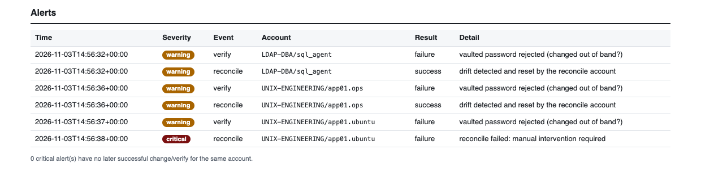

**Report: credential access from the Vault audit log**. The CPM AppRole reads credentials to verify them; the Database Team member `seriksen` (Vault login with directory credentials) can read the DBA safe and is denied the Engineering safe:

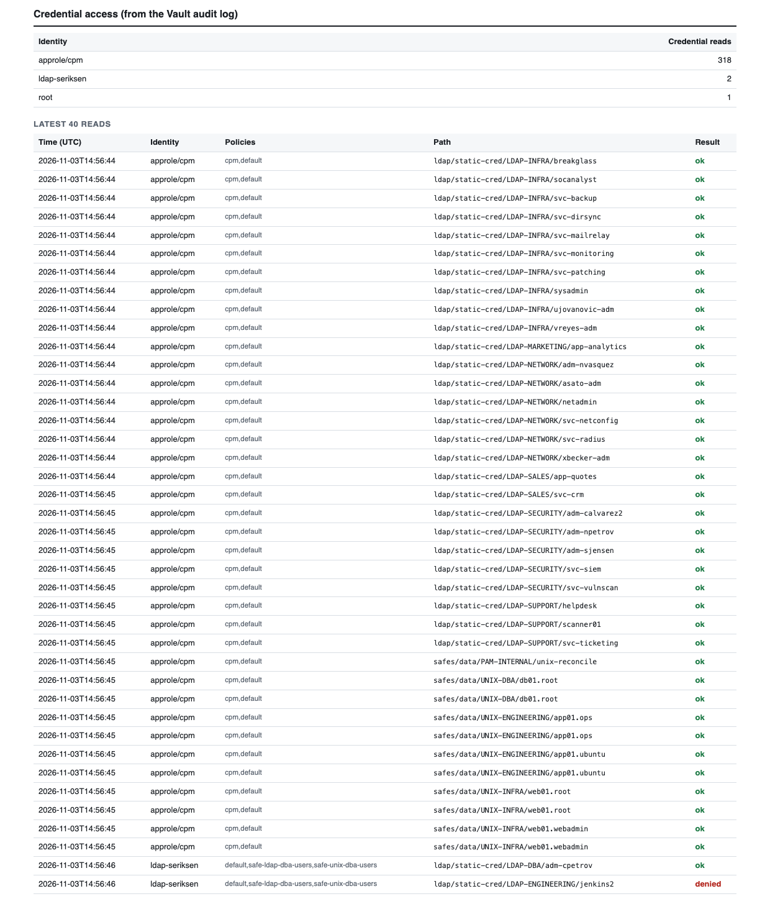

**Vault UI as the read-only auditor**: the safes, an onboarded account's custom metadata (platform, approver, plan hash, risk), and the same account's password, which the auditor is not allowed to read:

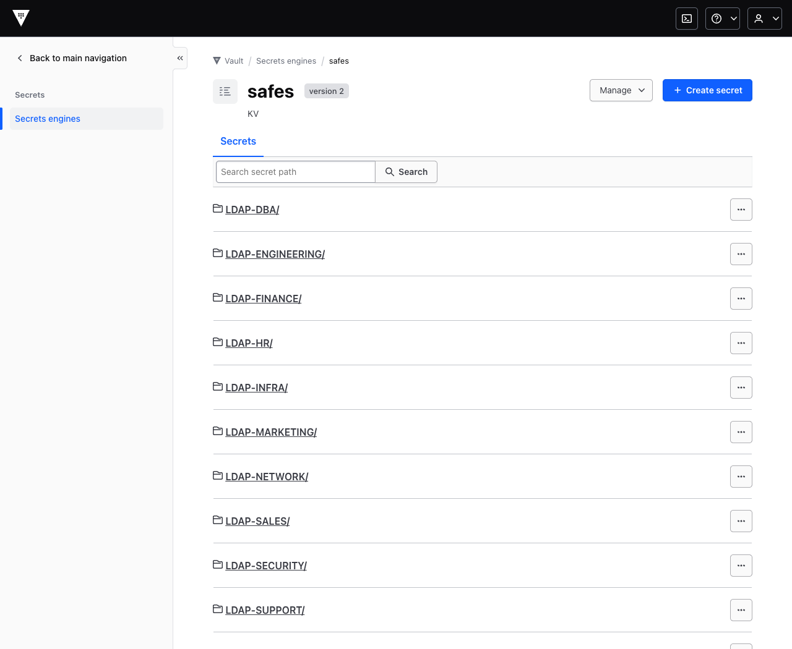
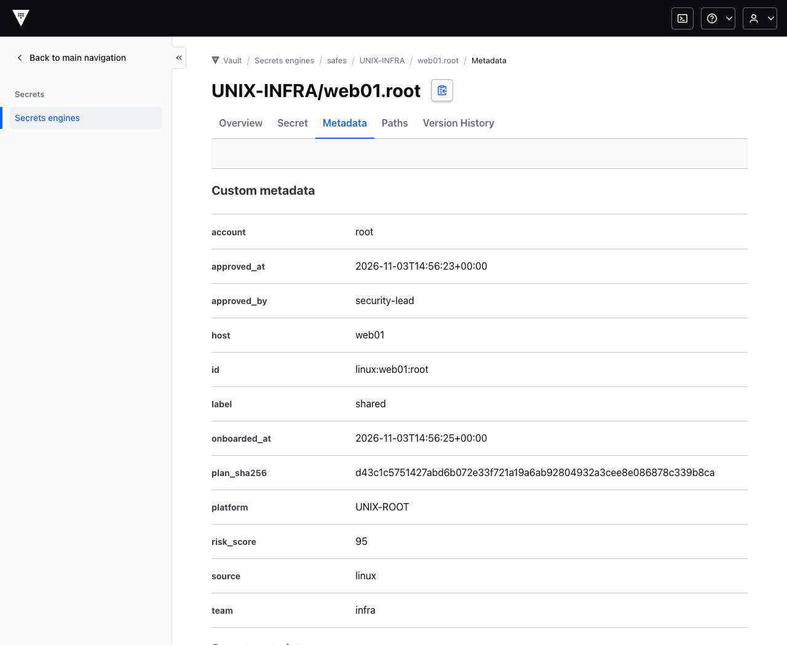
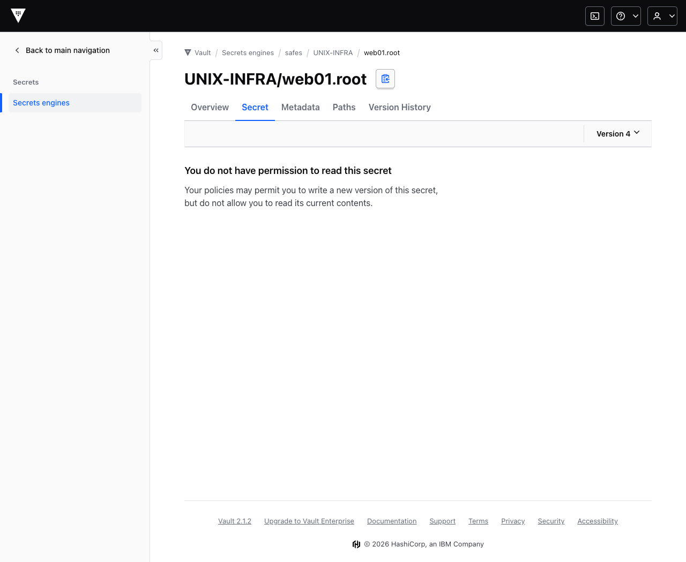

## Tests and CI

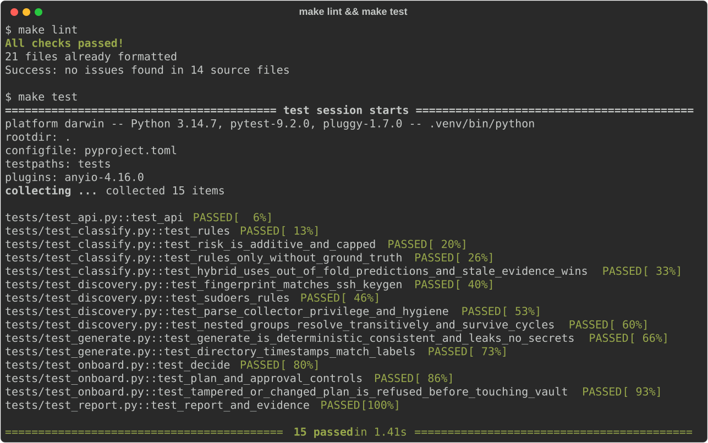

`make test` runs 15 unit tests:
- Collector and sudoers parsing, with the fingerprint checked against `ssh-keygen`.
- Nested groups with cycles.
- Rules and risk scoring, and the out-of-fold evaluation path.
- Onboarding decisions, segregation of duties and plan tampering.
- Report, evidence and demo-page generation.
- API auth.

Generator invariants are covered too: ground-truth consistency, no plaintext secrets, private-key permissions.

GitHub Actions (`.github/workflows/ci.yml`):
- **checks:** ruff, ruff format, mypy, pytest, gitleaks.
- **e2e:** runs the full `make demo` on a fresh runner and uploads the report and evidence bundle as artifacts.
